  
  
  

### `jack@jackwent:~$ cat about.md`

I've worked in IT for over 20 years and I'm now Head of Technical Delivery at an MSP. In my own time I run a homelab and a smart home of around 200 devices, and I write up what I build at **[jackwent.co.uk](https://jackwent.co.uk)**: Home Assistant, MQTT, Ubuntu servers, automation and a little AI. Everything runs in my own house first, with the mistakes left in.

I'm dyslexic, so I use an AI tool to help with spelling, grammar and clarity.

### `jack@jackwent:~$ ls -lh ~/projects`

| Project | What it does | Write-up |
| --- | --- | --- |
| [**HA-MQTT-Agent**](https://github.com/JackWent/HA-MQTT-Agent) | Puts your Ubuntu and Debian servers' CPU, memory, disk and pending updates on your Home Assistant dashboard, with signed self-updates | [Guide](https://jackwent.co.uk/monitor-ubuntu-servers-in-home-assistant-using-mqtt/) |
| [**Ubuntu-Auto-Update**](https://github.com/JackWent/Ubuntu-Auto-Update) | Keeps Ubuntu servers patched on its own: phased updates, kept-back packages, safe reboots and a Discord report | [Guide](https://jackwent.co.uk/ubuntu-24-04-autopatch-script/) |
| [**Jarvis**](https://github.com/JackWent/Jarvis) | The scripts, timers and runbooks behind an always-on Claude Code assistant that looks after my homelab | [Post](https://jackwent.co.uk/jarvis-ai-assistant-runs-my-homelab/) |
| [**Jarvis-AI-Desktop**](https://github.com/JackWent/Jarvis-AI-Desktop) | A 2.5 MB Tauri (Rust) Windows app for a self-hosted voice assistant: tray, hotkeys, autostart and toasts | [Post](https://jackwent.co.uk/jarvis-ai-windows-app-tauri/) |
| [**Crypto-Monitor**](https://github.com/JackWent/Crypto-Monitor) | A Monero mining dashboard with live hashrate, price history and daily email reports | [Post](https://jackwent.co.uk/xmr-mining-dashboard/) |

### `jack@jackwent:~$ ./games/block-the-attacks --autoplay`

The real one runs on the attacks my sites actually block. There are four games on the site, each with a leaderboard: [Block the Attacks](https://jackwent.co.uk/block-the-attacks/), [Patch the Fleet](https://jackwent.co.uk/patch-the-fleet/), the [Linux escape room](https://jackwent.co.uk/linux-escape-room/) and [Subnetle](https://jackwent.co.uk/subnetle/), a daily subnetting puzzle.

### `jack@jackwent:~$ snake --eat ~/contributions`

### `jack@jackwent:~$ tail -n 5 ~/blog/rss.xml`

<!-- BLOG-POST-LIST:START -->- `21 Nov 26` [Security Monitoring at Home with Wazuh](https://jackwent.co.uk/wazuh-security-monitoring-at-home/)
- `16 Nov 26` [pfSense CE and Plus Are Merging: What Changes in 26.10 and How I&#39;ll Upgrade](https://jackwent.co.uk/pfsense-26-10-ce-plus-merge/)
- `16 Nov 26` [Build a Windows App for Your Self-Hosted AI Assistant with Tauri &lpar;Rust&rpar;](https://jackwent.co.uk/jarvis-ai-windows-app-tauri/)
- `14 Nov 26` [Renaming My SaaS: SkillVortex Is Now SkillsLedger](https://jackwent.co.uk/renaming-skillvortex-to-skillsledger/)
- `07 Nov 26` [Hey Jarvis: A Web Page I Can Talk To](https://jackwent.co.uk/jarvis-talking-web-page/)
<!-- BLOG-POST-LIST:END -->

Free browser tools as well: a [subnet calculator](https://jackwent.co.uk/subnet-calculator/) for IPv4 and IPv6 and a [live map](https://jackwent.co.uk/live-attack-map/) of the attacks my sites block.
