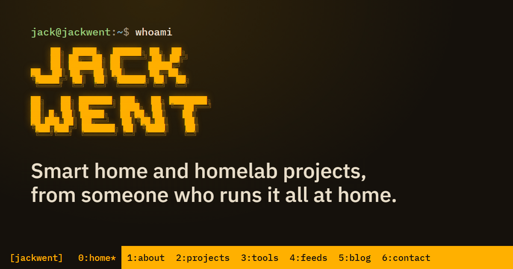

## Hi, I'm Jack

I've worked in IT for over 20 years and I'm now Head of Technical Delivery. In my own time I run a homelab and a smart home, and I write up what I build at **[jackwent.co.uk](https://jackwent.co.uk)**: Home Assistant, MQTT, Ubuntu servers, automation and a little AI.

I'm dyslexic, so I use an AI tool to help with spelling, grammar and clarity.

## Projects on GitHub

| Project | What it does | Write-up |
| --- | --- | --- |
| [**HA-MQTT-Agent**](https://github.com/JackWent/HA-MQTT-Agent) | Puts your Ubuntu and Debian servers' CPU, memory, disk and pending updates on your Home Assistant dashboard, with signed self-updates | [Guide](https://jackwent.co.uk/monitor-ubuntu-servers-in-home-assistant-using-mqtt/) |
| [**Ubuntu-Auto-Update**](https://github.com/JackWent/Ubuntu-Auto-Update) | Keeps Ubuntu servers patched on its own: phased updates, kept-back packages, safe reboots and a Discord report | [Guide](https://jackwent.co.uk/ubuntu-24-04-autopatch-script/) |
| [**Jarvis**](https://github.com/JackWent/Jarvis) | The scripts, timers and runbooks behind an always-on Claude Code assistant that looks after my homelab | [Post](https://jackwent.co.uk/jarvis-ai-assistant-runs-my-homelab/) |
| [**Crypto-Monitor**](https://github.com/JackWent/Crypto-Monitor) | A Monero mining dashboard with live hashrate, price history and daily email reports | [Post](https://jackwent.co.uk/xmr-mining-dashboard/) |

## Elsewhere

- Website and blog: [jackwent.co.uk](https://jackwent.co.uk)
- Free IT tools and games: [subnet calculator](https://jackwent.co.uk/subnet-calculator/), [Subnetle](https://jackwent.co.uk/subnetle/), [Linux escape room](https://jackwent.co.uk/linux-escape-room/)
- Videos: [YouTube](https://www.youtube.com/channel/UCo0a-Z8-aN6nGswFnPeuE4w)
- [LinkedIn](https://www.linkedin.com/in/jackwent)
